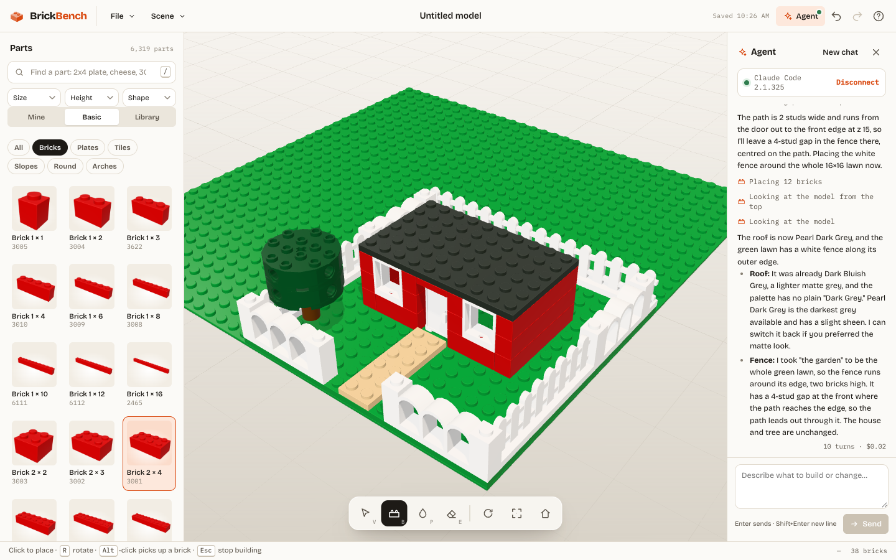

# BrickBench

A 3D brick-building workshop that runs in the browser. Pick parts and colours, snap them together on a baseplate, then save your model or export it to LDraw, glTF or an image. Models made in BrickLink Studio, LeoCAD and other LDraw editors open too.


## Features

- **87 basic parts in six families:** bricks (including tall 1×1×3 to 1×2×5), plates up to 16×16, tiles, slopes (45°, 33°, 65°, inverted, cheese), round parts and cones, and arches, all generated in code, and hollow underneath with tubes and pins as real bricks are.
- **The LDraw community parts library:** over 7,000 more parts, from Technic beams and hinges to wheels with their tyres, windows, doors and minifigure accessories, converted from the [LDraw](https://www.ldraw.org) library when the app is built. Parts made in several colours keep the colours they fix, so a wheel's tyre stays black whatever colour you build the wheel in. Each takes up only the space its shape fills, so a corner plate leaves its corner free and an arch its opening, and each mesh loads the first time you use it.
- **Finding the right part:**
  - **One search covers every part.** Type sizes any way ("2x4", "2 by 4", "two by four"), hobby nicknames ("cheese", "jumper", "macaroni", "SNOT"), US spellings ("tire", "windshield") or a part number, including BrickLink's. Sizes work either way round ("4x2" finds 2 × 4). Name a colour too ("red 2x4 brick") and the part is built in it. If you mistype, close spellings show instead.
  - **Size, height and shape filters** narrow thousands of parts to a handful: say 1 × 2, 1 plate, with a clip.
  - **Part patterns** describe parts the way regular expressions describe text, stud by stud: `S45[oo/..]` is a 45° slope with its studs at the back, `B1x(1|2)` a 1 × 1 or 1 × 2 brick. See [Part patterns](#part-patterns).
  - **Mine** keeps your starred favourites, recent picks and the parts already in your model. Favourites and picks stay in this browser, shared by its tabs.
  - **Keyboard first:** press `/`, type, use ↑ ↓ and press Enter to build with the part.
- **Build with the parts you own:** add the parts lists of your sets from Rebrickable or BrickLink, and BrickBench counts how many of each part you have left as you build. The parts list shows what's missing, and an agent can build from your parts too. See [Building with the parts you own](#building-with-the-parts-you-own).
- **Build with an AI agent:** ask Claude Code, from a chat panel in the app or from your terminal, to build or change the model. It places, paints and moves bricks while you watch, checks its work with pictures of the model, and one undo takes back a whole request.
- **68 colours:** solid, transparent and metallic, following the LDraw palette, the newer ones included (Dark Purple, Light Aqua, Warm Tan, Reddish Orange and more).
- **Grid snapping that understands bricks.** Point at a top face to stack, at a side to build beside it (lined up with that brick's courses), or underneath to hang below. Parts never overlap: the preview turns red when there's no room, and drops land on top of whatever is in the way.
- **Tools:** Build, Select & move (click, Shift-click, box select, drag to move), Paint and Erase, plus an eyedropper (Alt-click) and rotate, nudge, copy, paste and duplicate.
- **Unlimited undo** (up to 200 steps) and **autosave** in the browser.
- **Files:** save and open `.brickbench.json`, or load the sample cottage. **File › Copy share link** puts the whole model in a link: whoever opens it gets their own copy, with no server in between (links to big models get too long, and the file is the way to send those).
- **Open models from elsewhere:** LDraw files (`.ldr`, `.mpd`) and BrickLink Studio files (`.io`) open as BrickBench models, built in the model's own order, with a report on any parts that couldn't come in. Use File › Open, or drop a file on the window. See [Opening LDraw and Studio files](#opening-ldraw-and-studio-files).
- **A desktop app** for macOS, Windows and Linux, with the parts library inside, a native menu, and LDraw and Studio files opened from Finder or Explorer. See [Desktop app](#desktop-app).
- **Building instructions:** a printable PDF booklet with a cover, the parts list, then one page per step showing the parts to add and the model so far, with the new parts outlined.
- **Time-lapse video:** a video of your model being built, each brick dropping into place while the camera circles, ready to share. See [Time-lapse video](#time-lapse-video).
- **Exports:** LDraw (`.ldr`, opens in Studio, LeoCAD and LDView), glTF (`.glb`, at real-world scale for Blender), PNG, a time-lapse video (MP4 or WebM), and a parts list (CSV).
- **Fast with big models.** Resting bricks are instanced, one draw call per part type, and studs hidden under other bricks are skipped. Rendering only happens when something changes.

## Getting started

```bash
bun install
bun run ldraw      # once: downloads and converts the LDraw parts library (about 3 minutes)
bun run dev        # http://localhost:5173
```

Requires [Bun](https://bun.sh) 1.4 or later and a browser with WebGL 2. Bun runs everything outside the browser, so Node is not needed. Without GPU acceleration the app still runs, but skips shadows. Without `bun run ldraw` the app works with the basic parts, and the LDraw library tab explains how to add the rest.

## Controls

| Action | Mouse | Keyboard |
| --- | --- | --- |
| Place a part (Build) | Click, or drag a part tile onto the scene | |
| Orbit | Right-drag, Alt-drag, or left-drag in Build/Paint/Erase | |
| Pan / zoom | Middle-drag or Shift + right-drag / scroll or pinch | |
| Select | Click, Shift-click to add, drag a box on empty space | `⌘A` all |
| Move selection | Drag a selected brick | Arrows; `⇧↑` / `⇧↓` for one plate up or down |
| Rotate | | `R` (`⇧R` turns back) |
| Tools | | `V` select, `B` build, `P` paint, `E` erase |
| Copy / cut / paste / duplicate | | `⌘C` `⌘X` `⌘V` `⌘D` |
| Delete | | `Del` / `Backspace` |
| Undo / redo | | `⌘Z` / `⇧⌘Z` |
| Pick up a part and colour | Alt-click a brick | |
| Frame / reset view | | `F` / `Home` |
| Save / open | | `⌘S` / `⌘O` |
| Search parts / help | | `/` / `?` |
| Choose a search result | | `↑` `↓`, `Enter` builds with it, `Esc` clears |

On Windows and Linux, use Ctrl in place of ⌘.

## Building instructions

Choose **File › Building instructions (.pdf)…**, or **Instructions** in the Model panel, once your model is built.

- **Steps are planned for you.** "Bottom up" builds layer by layer and groups bricks that sit near each other, so every step can actually be built. "As you built it" follows the order you placed the bricks.
- **Parts per step:** 3, 6, 10, 20 or 40. Big models need bigger steps; booklets are limited to 400 pages, which fits models up to about 15,000 bricks.
- **Paper:** A4 or US Letter, landscape.
- **Pictures use your current view.** Turn the model to show its best side before you start. Every page uses the same view and scale, so the model grows in place from page to page. New parts get an outline that stays the same width in every picture: blue on red, orange, yellow and tan bricks, orange on the rest.

The PDF is made entirely in your browser: each step is drawn offscreen with three.js and laid out with [jsPDF](https://github.com/parallax/jsPDF), which loads only when you make a booklet.

## Time-lapse video

Choose **File › Time-lapse video…** to film your model going together, brick by brick, for a clip to share.

- **Order:** "As you built it" replays the order you placed the bricks; "Bottom up" builds layer by layer, as the instructions do.
- **Length:** 5 to 60 seconds. However many bricks the model has, they arrive evenly over the video, each dropping into place, and the finished model stays on screen for the last couple of seconds.
- **Shape and size:** landscape (16:9), square, or portrait (9:16) for phones, at 1080p or 720p, 30 frames a second.
- **Camera:** it starts on the side you are looking from, at about the same height (kept between a low and a high angle), and circles the model: once round for 20 seconds or more, part of the way for shorter videos. Untick the option to keep it still. It stays at one distance all the way round, as near as it can while keeping the whole model in the picture.
- **Brick count:** "312 / 1,504 bricks" in a corner as the bricks arrive, unless you turn it off.

The video is made in your browser and saved to your downloads: an MP4 (H.264), or a WebM where the browser can't make MP4. Frames are drawn offscreen in the editor's light and encoded with WebCodecs and [Mediabunny](https://mediabunny.dev) (MPL-2.0), which loads only when you make a video. On a computer with a graphics card, a 10-second 1080p video of a model of a few thousand bricks takes a few seconds; bigger models take longer, and software graphics much longer.

## Opening LDraw and Studio files

**File › Open…** also opens models made elsewhere: LDraw files (`.ldr`, `.mpd`) from LeoCAD, MLCad or the [LDraw model repository](https://library.ldraw.org/omr) of official sets, and BrickLink Studio files (`.io`), old and new. Submodels are built where the model puts them, in their colours. Parts come in in the model's own order, so a time-lapse of an opened model follows its building steps.

BrickBench builds upright parts, turned in quarter turns, on whole studs and plates. What doesn't fit stays out, and a report says what and why:

- **Not in BrickBench:** parts the library doesn't have.
- **On their side or at an angle:** parts tipped over, upside down or turned at an angle, as in sideways building.
- **Between studs:** parts on jumper plates, hinges and Technic pins.
- **Overlapping:** parts that would overlap others once on the grid, such as a tyre on its wheel or glass in its frame.
- **Drawing shapes** (strings and wires a model draws itself) and **submodels kept in other files**.

To bring in as much as it can, it also:

- **finds the grid the model was built on**, wherever the editor put it, and moves a submodel built a little off the rest (a train body resting just above its bogies) by up to half a stud or plate, as one piece, to line up;
- **turns submodels square** that a model stands at an angle for show, such as a car parked at 30°;
- builds **printed and stickered parts plain**, and **colours** BrickBench doesn't have (Light Grey, Brown) in the nearest it does.

The model stands in the middle of the scene on a baseplate big enough to hold it, or on none if it brings its own.

How much of a model comes in depends on how it is built. In a sample of official sets from the LDraw model repository, houses, trains and vehicles came in at 53 to 77% of their parts; models built mostly sideways, such as a Star Destroyer, at under 20%.

Studio files are ZIP archives: BrickBench reads the LDraw model inside with [zip.js](https://gildas-lormeau.github.io/zip.js/) (BSD-3-Clause), which loads only when you open one.

## Building with the parts you own

Choose **File › Your parts…**, or **Add their parts lists** under **Mine** in the parts panel, and add a parts list for each set you own:

- **From Rebrickable:** open a set's inventory and choose Export Parts, as Rebrickable CSV or BrickLink XML. A CSV with Part, Color and Quantity columns works too, such as an export of all your parts.
- **From BrickLink:** download a set's inventory as XML. Wanted lists and BrickStore files work too.

Set how many copies of a set you have, and BrickBench counts with all of them:

- **Mine** gets a **Parts you own** section: every part in the colours you have, each with how many are left. Click one to build with it in that colour.
- **Part tiles** say how many you have left in the colour they show (under "In this model", how many the model uses). The count turns red when the model uses more than you have.
- **The Owned filter** over the search box keeps a search to your parts.
- **Building with** in the inspector says how many of the part, in the current colour, are left.
- **The parts list** gets Have and Missing columns, in the CSV as well, so you know what to buy. **Buy missing parts** there writes what you lack as a BrickLink wanted list (`.xml`, for Wanted › Upload) or a Rebrickable parts list (`.csv`), in each catalogue's own part numbers and colours. Without sets added, it lists every part the model uses.
- **An agent** can see your parts: ask it to build something from your sets, and it is told whenever a change uses more of a part than you have.

**How lists are matched.** BrickLink and Rebrickable mostly number parts as LDraw does. Where they differ, LDraw parts note the other numbers ("BrickLink 4073" on 6141), and the library build records the numbers LDraw moved or merged (3040 is now 3040b). Colours are matched with Rebrickable's table of colour numbers. Checked against Rebrickable's inventories of 3,145 sets from 2018 on, about 98% of their parts match. The rest are listed with each set, with the reason: mostly printed parts, which BrickBench doesn't have yet, and parts too new for the LDraw library. Minifigures and alternate parts in BrickLink inventories are left out, and you are told how many. A list added while the parts library could not load is matched again once it does, as are all lists when a rebuilt library has more parts.

Your lists stay in this browser, like favourites, and are shared by its tabs.

## Part patterns

Type a part pattern in the search box to say exactly which parts you mean; the **?** beside the box lists the syntax, with examples to try. A capital letter gives the kind, then a size, a top face and a height can follow:

| Pattern | Finds |
| --- | --- |
| `P2x4` | 2 × 4 plates |
| `B1x(1\|2)` | 1 × 1 and 1 × 2 bricks |
| `B1x2x5` | 1 × 2 bricks five bricks tall |
| `S45 2x2` | 2 × 2 slopes at 45° |
| `S45[oo/..]` | 45° slopes with two studs at the back and the slope at the front |
| `T[..]{2}` | tiles with two rows of two smooth cells |
| `[o_/oo]` | anything shaped like a corner plate, with studs on top |
| `P1x2 +clip` | 1 × 2 plates with a clip |
| `@owned S :red` | slopes from your sets, to build in red |

In the brackets, rows go from the back of the part to the front: `o` is a stud, `.` a cell without one, `_` a cell the part leaves out and `#` any cell, with `*`, `+`, `?`, `{2,4}`, `( | )` and `[ ]` as in regular expressions. Terms side by side must all hold, `|` gives a choice and `!` a "not". Library parts have `#` for their cells, since the library doesn't say where their studs are.

Agents get each part's own pattern from `find_parts`, such as `S45[oo/..]^3=3039`, so they know where a part has its studs. [docs/part-patterns.md](docs/part-patterns.md) defines the language in full; its tests check every example there.

## Desktop app

BrickBench also runs as a desktop app, built with [Electron](https://www.electronjs.org): the same app, with the parts library inside it, so it works offline.

- **Open models from your desktop:** choose BrickBench in a file's **Open With** menu for LDraw (`.ldr`, `.mpd`) and Studio (`.io`) files (it offers to open them without taking them over from other apps), drop a file on the window or on the Dock icon, or use **File › Open…**.
- **A native menu** with File, Edit and View. The keys work as in the browser: ⌘Z undoes in the scene, and undoes your typing in a text box.
- **Saving** asks where to save, as other desktop apps do, then says where the file went (and nothing if you cancel).
- **Your work stays in the app:** autosave, favourites and your parts lists are kept in the app's own storage, apart from your browser's.
- **The agent chat** works too, once the agent bridge runs (`bun run agent`, as for the browser).

To run it from this repository, `bun run desktop` builds the web app and opens it in Electron (`bun scripts/desktop.ts start --skip-web` reuses the last build). To make an installer, `bun run desktop:dist` builds everything and writes it to `release/`: a `.dmg` on macOS, an installer on Windows and an AppImage on Linux. Build each on its own system; `bun scripts/desktop.ts dist --dir` makes just the app, unpacked, which is quicker to try. The installers aren't signed with a developer certificate yet (that needs an Apple Developer ID and a Windows code-signing certificate). The macOS app is signed ad hoc, so the first time you open a downloaded copy, macOS needs **right-click › Open**; Windows asks before running the installer.

**How it works.** Electron shows the built web app from a scheme of its own, `brickbench://app`, which serves only the app's own files (a `file://` page couldn't load the parts library). The page runs sandboxed, with no access to Node or your files; a small preload script passes it menu commands and the files you open. Links to websites open in your browser, and the page can't navigate anywhere else. The main process is in `electron/`, bundled by Bun; `bun run e2e:desktop` builds the app and runs its tests in Electron, and with `BRICKBENCH_DESKTOP_APP` set to a packaged app's executable, `bunx --bun playwright test -c playwright.desktop.config.ts` runs them against that instead. The tests keep their own storage, apart from your copy of the app.

## Building with an AI agent

An AI agent can build in BrickBench: Claude Code from the **Agent** panel in the app, or Claude Code (or any other agent that speaks [MCP](https://modelcontextprotocol.io)) from a terminal. It places, paints, moves and removes bricks while you watch, looks at pictures of the model to check its work, and whatever it does for one request is one step you can undo.



1. Start the agent bridge, a small server on your computer, in a terminal in the BrickBench folder:

   ```bash
   bun run agent
   ```

2. Open BrickBench and click **Agent** in the top bar. Ask for something: "build a small red house with a door and two windows", "make the roof dark grey", "put a fence around it".

The chat runs [Claude Code](https://code.claude.com) on your computer with your own login, so Claude Code has to be installed. It gets the BrickBench tools and nothing else: no shell, no files, and none of your Claude Code hooks, plugins or settings files. That use of your login is meant for you on your own computer; if other people will use the chat, set `ANTHROPIC_API_KEY` for the bridge so it runs on an API key instead.

**From a terminal.** With the bridge running and BrickBench open, add BrickBench to Claude Code once:

```bash
claude mcp add --transport http brickbench http://127.0.0.1:7425/mcp
```

then ask Claude Code to build something in BrickBench. Any MCP client can use the same address. Agents build in the BrickBench tab you used last, and once the Agent panel has connected, BrickBench reconnects by itself on later visits (until you click Disconnect).

**The tools agents get:**

| Tool | What it does |
|---|---|
| `get_model` | The model's name, size, parts and colours, and its bricks with their ids, optionally only those in a region |
| `find_parts` | Searches parts like the search box does, by words or [part pattern](#part-patterns), and returns part ids with their sizes and patterns; with your sets added, also the colours you own and how many are left, or only your parts |
| `list_colors` | The colours, with names and LDraw codes |
| `list_owned_parts` | The parts of your sets, each part and colour with how many you own, the model uses and are left |
| `place_bricks` | Places up to 2,000 parts at once; refuses any that would overlap or leave the build area, with the reason, and points out bricks with nothing holding them up and parts the model now uses more of than you own |
| `paint_bricks`, `move_bricks`, `remove_bricks` | Change bricks named by id or reached by a region; painting, too, points out parts the model now uses more of than you own |
| `look` | A picture of the model from any side, with bricks outlined if asked |
| `set_model_name`, `undo`, `clear_model` | Rename, undo steps, or start afresh (only when you ask) |

**Settings** (environment variables for `bun run agent`):

| Variable | What it sets |
|---|---|
| `BRICKBENCH_AGENT_PORT` | The bridge's port, 7425 by default. Open BrickBench with `?agentPort=` and the same number to match. |
| `BRICKBENCH_AGENT_MODEL` | The model the chat uses, such as `sonnet` or `opus`; Claude Code's default otherwise |
| `BRICKBENCH_AGENT_BUDGET_USD` | The most one chat request may spend: $5 unless you set it, or `none` for no cap |
| `BRICKBENCH_CLAUDE` | Where the `claude` command is, if it is not on your PATH |
| `BRICKBENCH_AGENT_ORIGINS` | The only pages that may connect, comma-separated, such as `http://localhost:5173` |

The bridge listens on this computer only (127.0.0.1) and answers only pages served from this computer. Any of them could start the chat, so if you run other web servers you do not trust, set `BRICKBENCH_AGENT_ORIGINS` to BrickBench's own address.

## Scripts

| Command | What it does |
| --- | --- |
| `bun run dev` | Start the dev server (Vite) |
| `bun run build` | Type-check, build the LDraw library if it is missing, and build to `dist/` |
| `bun run ldraw` | Download and convert the LDraw parts library into `public/ldraw/` |
| `bun run agent` | Start the agent bridge, so Claude Code and other MCP agents can build in BrickBench |
| `bun test` | Run the unit tests (`bun test`, about a second) |
| `bun run coverage` | Run the unit tests with coverage; fails if any file drops below 80% of its lines or functions |
| `bun run e2e` | Run the browser tests (Playwright; starts the dev server itself) |
| `bun run desktop` | Build the web app and open it in the desktop app (Electron) |
| `bun run desktop:dist` | Build everything and package the desktop app into `release/` |
| `bun run e2e:desktop` | Build the desktop app and run its tests in Electron |
| `bun run typecheck` | Type-check the app, tests and tooling with `bun check` |

The first time you run the browser tests, install a browser with `bunx playwright install chromium`. Unit tests share one process, so they must not depend on each other's state: `bun test --randomize` and `bun test --isolate` should pass too.

`bun scripts/colourNumbers.ts <colours.json> <LDConfig.ldr>` rewrites the table that matches Rebrickable's and BrickLink's colour numbers to LDraw's, from Rebrickable's colour list (as its API gives it) and LDraw's colour table. Run it when the catalogues add colours.

`bun scripts/ldrawColours.ts .ldraw-cache/ldraw/LDConfig.ldr` rewrites the table of every LDraw colour (name, value and finish) that opened models in colours outside the palette are matched by. Run it when LDraw adds colours.

### Checking LDraw mappings

Each part records its LDraw part number and where the LDraw origin sits on it, which keeps exports correctly placed and turned. A test compares every part against the real LDraw library:

```bash
bun run ldraw --fetch-only    # downloads the library into .ldraw-cache/ldraw, if you have not yet
LDRAW_DIR=.ldraw-cache/ldraw bun test src/core/parts/ldraw.verify.test.ts src/core/io/ldrawExport.verify.test.ts
```

`LDRAW_DIR=.ldraw-cache/ldraw bun test verify` runs every check against the real library.

The first file checks each part's size, origin and slope direction. The second exports every part at all four rotations and confirms the LDraw part lands exactly where the brick sits. Without `LDRAW_DIR` both are skipped. Run them whenever you add or change a part.

### Continuous integration

GitHub Actions runs `.github/workflows/test.yml` on every push to `main` and on every pull request, in two jobs, plus a third that deploys the site once it is [set up](#hosting):

- **Type check and unit tests:** `bun run typecheck` and `bun run coverage`, about a minute.
- **LDraw checks and browser tests:** builds the LDraw library, runs `bun test verify` against it, builds the app, then runs `bun run e2e` against that build in headless Chromium. The library download and the converted library are cached, so only the first run, or one after the converter changes, spends a few minutes converting. Traces of failed browser tests are kept for a week as a `playwright-traces` artifact.

The runners have no GPU, so WebGL is drawn on the CPU: with `CI` set, Playwright tests the production build (`vite preview`, which sends the hosted site's headers and security policy; any test whose page breaks the policy fails) one test at a time, gives each test two minutes, retries once, and stops after three failures. Run the same way locally with `bunx --bun vite build && CI=1 bun run e2e`. The browser tests also start the agent bridge, on port 7499, with a stand-in for Claude Code that builds through MCP, so they spend nothing on a real model.

To pick up a newer LDraw release in CI, bump `ldraw-download-v1` in the workflow.

### Hosting

BrickBench is a static site: `bun run build` writes it to `dist/`, about 190 MB in some 7,800 files, nearly all of them the parts library. It needs no server of its own, and the parts are stored compressed, which the app undoes itself, so any static host serves it as it is. The build also writes `third-party-licences.txt`, the licences of the packages bundled into it, which About links to.

The workflow deploys to [Cloudflare Pages](https://pages.cloudflare.com) after both test jobs pass on `main`. To switch it on:

1. In Cloudflare, create a Pages project for direct upload (no Git connection), and an API token allowed to edit Cloudflare Pages. Note your account ID.
2. In the GitHub repository's settings, add the secrets `CLOUDFLARE_API_TOKEN` and `CLOUDFLARE_ACCOUNT_ID`, and the variable `CLOUDFLARE_PROJECT` set to the project's name.
3. Push to `main`, or run the workflow by hand. The **Deploy to Cloudflare Pages** job uploads the build; Cloudflare sends only files that changed.
4. Add your domain to the project under Custom domains. Cloudflare sets up HTTPS.

`public/_headers` sets the hosted site's response headers: a Content Security Policy, other security headers, and how long browsers keep files (the app's own for good, since their names change with every build; library files for a day). The agent chat on a hosted site still talks to the bridge on each visitor's own computer: start it with `BRICKBENCH_AGENT_ORIGINS=https://your-domain bun run agent` to let the site's page in.

## The LDraw parts library

`bun run ldraw` turns the [LDraw parts library](https://library.ldraw.org) into files the app can load quickly, in `public/ldraw/` (not committed; `bun run build` makes it whenever it is missing, incomplete or partial):

- `index.json` lists every part: its name, category, keywords, author, how it sits on the grid and, when it leaves some of its box empty, which cells it fills. It also lists the part numbers LDraw moved or merged, each with the part it now is (4073 is 6141), so parts lists that use the old numbers still match.
- `parts/<number>.bin` holds one mesh per part: gzip-compressed, 16-bit positions and 8-bit normals, with its triangles in runs by colour when the part fixes colours of its own. A 2 × 4 brick is under 5 kB.
- `CREDITS.txt` names the author of every part and of every primitive it uses, and copies of the LDraw licence files sit alongside.
- `build.json` says the build is complete and, for downloads, records the archive's SHA-256. `complete.zip` always holds the latest LDraw release; keep a copy and pass `--library` to pin one.

A build is written to `public/ldraw.partial/` and swapped in only when it has finished, so an interrupted run leaves the previous library in place. The tool only ever deletes folders it built itself.

The converter (`scripts/ldraw/`) follows each part's sub-files and primitives, honouring LDraw's back-face rules (winding, inverted and mirrored references, double-sided sections), drops edge lines, smooths curved surfaces, and moves the part so its body stands centred on its footprint with the top studs over cell centres. Parts drawn in several colours, such as wheels with their tyres, keep the colours they fix, read from LDraw's colour table (`LDConfig.ldr`), apart from the part's own. It leaves out printed and sticker parts, obsolete and alias files and third-party parts, and the two twisted strings whose meshes run past 200,000 vertices. That leaves about 7,700 parts and 175 MB of meshes in as many files.

```bash
bun run ldraw                                # download complete.zip into .ldraw-cache/ and convert everything
bun run ldraw --library /path/to/ldraw       # or LDRAW_DIR=…: use a library you already have
bun run ldraw --only 3001,3003,3040b         # just these parts, handy while developing (a partial build)
bun run ldraw --limit 200                    # the first 200 parts (also partial)
bun run ldraw --fetch-only                   # just download and unpack it into .ldraw-cache/ldraw
```

In the app, library parts are ordinary parts with ids like `ldraw:3001`. Each sits in the smallest box of whole cells that holds its body (a fifth of a stud may stick out on a side), placed so its top studs sit over cell centres, so it stacks and collides like any brick. Within that box it fills only the cells its shape takes up: the missing corner of a corner plate, the opening of an arch, window or door frame, and the space under a bracket's overhang stay free for other parts. A cell counts as filled when the part reaches two LDraw units or more into it, or when the part closes it in on every side and from above, as it does the hollow underside of a brick. Jumper plates keep their half-stud offset. A part drawn in several colours takes the colour you choose wherever LDraw draws it in the part's own colour; the colours it fixes are drawn as the palette's version of that colour when there is one, and as LDraw defines them otherwise. While a mesh loads, a plain box of the right size stands in; parts that fail to load are retried when the connection comes back.

Opening a model or restoring the autosave loads the library index first. If bricks still cannot be restored, say because the library is unreachable or a rebuilt library gave a part a different size, the whole session is kept and **File › Recover earlier session** opens it later.

Two opt-in tests convert real parts: one checks that every built-in part's LDraw file comes out with exactly the built-in footprint, height and origin (and is not an outdated "moved" file), the other spot-checks meshes and skipped parts:

```bash
LDRAW_DIR=.ldraw-cache/ldraw bun test src/core/parts/libraryFit.verify.test.ts scripts/ldraw/library.verify.test.ts
```

## How it is built

TypeScript, [three.js](https://threejs.org) for rendering, React for the panels, [zustand](https://zustand.docs.pmnd.rs) for state and [zod](https://zod.dev) to validate files. Vite builds it. [Bun](https://bun.sh) installs the packages and runs the scripts, the LDraw converter, the unit tests and type checking, and runs Vite and Playwright too.

```
src/
  core/       pure logic, no three.js: units and rotation, colours, part catalogue
              and part finder (search, nicknames, filters, part patterns),
              immutable model operations, spatial index, picking and placement,
              undo history, file format, LDraw and Studio import, LDraw and
              parts-list export, and
              instruction steps, page layout and camera framing
  engine/     three.js: procedural part geometry, library mesh loading, instanced
              batches, selection and preview layers, ground, viewport, thumbnails,
              glTF export
  editor/     connects state and scene: pointer gestures, keyboard, drag and drop
  state/      zustand store and actions, selectors, autosave, file commands
  ui/         React panels, dialogs and toasts
  agent/      the build tools agents call, the link to the agent bridge, and the chat
  instructions/  building-instruction booklets: rendering steps and writing the PDF
  desktop/    what the desktop app and the page say to each other
  samples/    the sample cottage
scripts/ldraw/  the LDraw library converter (run straight from TypeScript by Bun)
agent/        the agent bridge: an MCP server for agents, a WebSocket for BrickBench tabs,
              and Claude Code run headless for the chat
electron/     the desktop app's main process and preload script
e2e/          Playwright tests (e2e-desktop/: the desktop app's)
```

**Grid and units.** One world unit is one stud pitch (8 mm). Bricks snap to whole studs on X/Z and whole plates (3.2 mm) on Y. A brick is stored as its part, its colour and the corner of its footprint, plus a quarter-turn rotation.

**Placement.** Picking intersects the cursor ray with the boxes each part fills (arches leave their opening free, and library parts fill only the cells their shape takes up), so it never needs triangle tests. The solver turns the face that was hit into a grid position, and a spatial index answers "who fills this cell?" in constant time for collision checks.

**Geometry.** Parts are built from three generators: a beveled loft along an axis (boxes, slopes, arches), a lathe (round parts, cones, studs) and filleted 2D paths. Explicit normals keep bevels smooth and flat faces flat.

### File format

```json
{
  "format": "brickbench.model",
  "version": 1,
  "name": "Garden cottage",
  "settings": { "baseplateSize": 32, "baseplateColor": 2 },
  "bricks": [{ "part": "brick-2x4", "color": 4, "x": 0, "y": 0, "z": 0, "r": 0 }]
}
```

`x`/`z` are in studs, `y` is in plates and `r` is quarter turns. Parts from the LDraw library are written as `ldraw:` plus their LDraw number, e.g. `ldraw:3001`. Colours are LDraw colour codes. Files are validated on load: unknown parts, bricks off the grid and bricks that overlap others are skipped, unknown colours are replaced, and you get a warning for each. Models are limited to 50,000 bricks and 2 million grid cells.

## Adding a part

1. Add it to `src/core/parts/catalog.ts`. The helpers (`rectangular`, `slope`, `round`, `arch`) cover the existing families; give the LDraw file and, if it isn't the default, the LDraw origin.
2. Run `bun test`. Every part is checked for a clean mesh, a sensible footprint and stud layout.
3. Run the LDraw check above.

## Not done yet

- Connections beyond the stud grid: library parts snap to whole studs and plates, so hinges don't swing, Technic pins don't plug into holes, minifigures don't assemble and half-stud offsets (jumper plates) aren't possible
- Printed library parts (printed tiles, minifigure faces and torsos)
- Ambient occlusion and a photoreal render mode
- Editing instruction steps by hand, sub-assemblies and per-step camera angles (steps are planned automatically)
- Accounts and a gallery (models are shared by file or by link for now)

## Privacy

BrickBench has no accounts and no server of its own. Your models, favourite and recent parts, and parts lists stay in your browser's storage (in the desktop app, on your computer). It downloads only its own files, such as the LDraw parts you use, from wherever it is hosted, with no tracking or adverts. If you connect an AI agent, what you ask it and the model it works on go to that agent: with Claude Code, to Anthropic under your own account. A share link carries the model after its `#`, which browsers never send to the site. **About & privacy**, at the foot of the parts panel, says the same in the app, with the credits and trademark notices.

## Licence

BrickBench is released under the [MIT Licence](LICENSE). That covers its own code. The LDraw parts library that `bun run ldraw` builds, and the desktop app ships, keeps its own licence (CC BY 4.0, older parts CC BY 2.0; see below), as do the packages BrickBench uses.

## Credits

Part numbers, colour codes and colour values follow the [LDraw](https://www.ldraw.org) standard. The library parts are converted from the LDraw.org Parts Library, made by its contributors and licensed under [CC BY 4.0](https://creativecommons.org/licenses/by/4.0/) (older contributions also [CC BY 2.0](https://creativecommons.org/licenses/by/2.0/)); `bun run ldraw` writes the full credits to `public/ldraw/CREDITS.txt`, and the app links to them. LDraw™ is a trademark of the Estate of James Jessiman.

Rebrickable's and BrickLink's colour numbers are matched to LDraw's with [Rebrickable](https://rebrickable.com)'s colour cross-references (`src/core/inventory/colourNumbers.ts`, written by `scripts/colourNumbers.ts`). Opened models' colours are matched with LDraw's colour table, LDConfig.ldr (`src/core/io/ldrawImport/colourTable.ts`, written by `scripts/ldrawColours.ts`).

The desktop app is built with [Electron](https://www.electronjs.org) and [electron-builder](https://www.electron.build) (both MIT).

Studio files are read with [zip.js](https://gildas-lormeau.github.io/zip.js/) (BSD-3-Clause). BrickLink Studio is BrickLink's; BrickBench reads the LDraw model it saves, as the [LDraw wiki](https://wiki.ldraw.org/wiki/Studio) describes.

LEGO® is a trademark of the LEGO Group, which does not sponsor, authorise or endorse this project.
