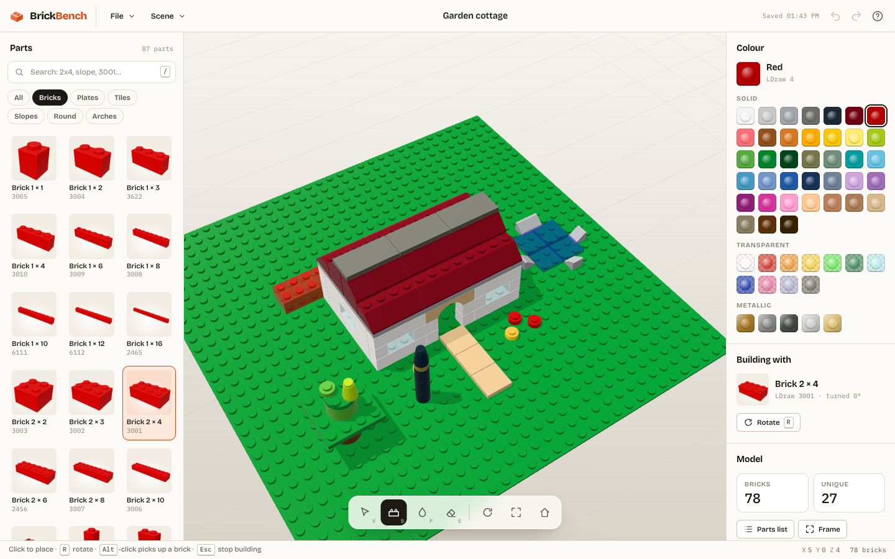

# BrickBench

A 3D brick-building workshop that runs in the browser. Pick parts and colours, snap them together on a baseplate, then save your model or export it to LDraw, glTF or an image.



## Features

- **87 basic parts in six families:** bricks (including tall 1×1×3 to 1×2×5), plates up to 16×16, tiles, slopes (45°, 33°, 65°, inverted, cheese), round parts and cones, and arches, all generated in code.
- **The LDraw community parts library:** over 6,000 more parts, from Technic beams and hinges to wheels, windows, doors and minifigure accessories, converted from the [LDraw](https://www.ldraw.org) library when the app is built. Browse them by category or search by name or part number; each mesh loads the first time you use it.
- **54 colours:** solid, transparent and metallic, following the LDraw palette.
- **Grid snapping that understands bricks.** Point at a top face to stack, at a side to build beside it (lined up with that brick's courses), or underneath to hang below. Parts never overlap: the preview turns red when there's no room, and drops land on top of whatever is in the way.
- **Tools:** Build, Select & move (click, Shift-click, box select, drag to move), Paint and Erase, plus an eyedropper (Alt-click) and rotate, nudge, copy, paste and duplicate.
- **Unlimited undo** (up to 200 steps) and **autosave** in the browser.
- **Files:** save and open `.brickbench.json`, or load the sample cottage.
- **Building instructions:** a printable PDF booklet with a cover, the parts list, then one page per step showing the parts to add and the model so far, with the new parts outlined.
- **Exports:** LDraw (`.ldr`, opens in Studio, LeoCAD and LDView), glTF (`.glb`, at real-world scale for Blender), PNG, and a parts list (CSV).
- **Fast with big models.** Resting bricks are instanced, one draw call per part type, and studs hidden under other bricks are skipped. Rendering only happens when something changes.

## Getting started

```bash
bun install
bun run ldraw      # once: downloads and converts the LDraw parts library (about 3 minutes)
bun run dev        # http://localhost:5173
```

Requires [Bun](https://bun.sh) 1.4 or later and a browser with WebGL 2. Bun runs everything outside the browser, so Node is not needed. Without GPU acceleration the app still runs, but skips shadows. Without `bun run ldraw` the app works with the basic parts, and the LDraw library tab explains how to add the rest.

## Controls

| Action | Mouse | Keyboard |
| --- | --- | --- |
| Place a part (Build) | Click, or drag a part tile onto the scene | |
| Orbit | Right-drag, Alt-drag, or left-drag in Build/Paint/Erase | |
| Pan / zoom | Middle-drag or Shift + right-drag / scroll or pinch | |
| Select | Click, Shift-click to add, drag a box on empty space | `⌘A` all |
| Move selection | Drag a selected brick | Arrows; `⇧↑` / `⇧↓` for one plate up or down |
| Rotate | | `R` (`⇧R` turns back) |
| Tools | | `V` select, `B` build, `P` paint, `E` erase |
| Copy / cut / paste / duplicate | | `⌘C` `⌘X` `⌘V` `⌘D` |
| Delete | | `Del` / `Backspace` |
| Undo / redo | | `⌘Z` / `⇧⌘Z` |
| Pick up a part and colour | Alt-click a brick | |
| Frame / reset view | | `F` / `Home` |
| Save / open | | `⌘S` / `⌘O` |
| Search parts / help | | `/` / `?` |

On Windows and Linux, use Ctrl in place of ⌘.

## Building instructions

Choose **File › Building instructions (.pdf)…**, or **Instructions** in the Model panel, once your model is built.

- **Steps are planned for you.** "Bottom up" builds layer by layer and groups bricks that sit near each other, so every step can actually be built. "As you built it" follows the order you placed the bricks.
- **Parts per step:** 3, 6, 10, 20 or 40. Big models need bigger steps; booklets are limited to 400 pages, which fits models up to about 15,000 bricks.
- **Paper:** A4 or US Letter, landscape.
- **Pictures use your current view.** Turn the model to show its best side before you start. Every page uses the same view and scale, so the model grows in place from page to page. New parts get an outline that stays the same width in every picture: blue on red, orange, yellow and tan bricks, orange on the rest.

The PDF is made entirely in your browser: each step is drawn offscreen with three.js and laid out with [jsPDF](https://github.com/parallax/jsPDF), which loads only when you make a booklet.

## Scripts

| Command | What it does |
| --- | --- |
| `bun run dev` | Start the dev server (Vite) |
| `bun run build` | Type-check, build the LDraw library if it is missing, and build to `dist/` |
| `bun run ldraw` | Download and convert the LDraw parts library into `public/ldraw/` |
| `bun test` | Run the unit tests (`bun test`, about a second) |
| `bun run coverage` | Run the unit tests with coverage; fails if any file drops below 80% of its lines or functions |
| `bun run e2e` | Run the browser tests (Playwright; starts the dev server itself) |
| `bun run typecheck` | Type-check the app, tests and tooling with `bun check` |

The first time you run the browser tests, install a browser with `bunx playwright install chromium`. Unit tests share one process, so they must not depend on each other's state: `bun test --randomize` and `bun test --isolate` should pass too.

### Checking LDraw mappings

Each part records its LDraw part number and where the LDraw origin sits on it, which keeps exports correctly placed and turned. A test compares every part against the real LDraw library:

```bash
bun run ldraw      # downloads the library into .ldraw-cache/ldraw, if you have not yet
LDRAW_DIR=.ldraw-cache/ldraw bun test src/core/parts/ldraw.verify.test.ts src/core/io/ldrawExport.verify.test.ts
```

The first file checks each part's size, origin and slope direction. The second exports every part at all four rotations and confirms the LDraw part lands exactly where the brick sits. Without `LDRAW_DIR` both are skipped. Run them whenever you add or change a part.

## The LDraw parts library

`bun run ldraw` turns the [LDraw parts library](https://library.ldraw.org) into files the app can load quickly, in `public/ldraw/` (not committed; `bun run build` makes it whenever it is missing, incomplete or partial):

- `index.json` lists every part: its name, category, keywords, author and how it sits on the grid.
- `parts/<number>.bin` holds one mesh per part: gzip-compressed, 16-bit positions and 8-bit normals. A 2 × 4 brick is under 5 kB.
- `CREDITS.txt` names the author of every part and of every primitive it uses, and copies of the LDraw licence files sit alongside.
- `build.json` says the build is complete and, for downloads, records the archive's SHA-256. `complete.zip` always holds the latest LDraw release; keep a copy and pass `--library` to pin one.

A build is written to `public/ldraw.partial/` and swapped in only when it has finished, so an interrupted run leaves the previous library in place. The tool only ever deletes folders it built itself.

The converter (`scripts/ldraw/`) follows each part's sub-files and primitives, honouring LDraw's back-face rules (winding, inverted and mirrored references, double-sided sections), drops edge lines, smooths curved surfaces, and moves the part so its body stands centred on its footprint with the top studs over cell centres. It leaves out printed and sticker parts, obsolete and alias files, third-party parts, and parts drawn in more than one fixed colour, such as wheels with their tyres. It also leaves out the two twisted strings whose meshes run past 200,000 vertices. That leaves about 6,300 parts and 110 MB of meshes in as many files.

```bash
bun run ldraw                                # download complete.zip into .ldraw-cache/ and convert everything
bun run ldraw --library /path/to/ldraw       # or LDRAW_DIR=…: use a library you already have
bun run ldraw --only 3001,3003,3040b         # just these parts, handy while developing (a partial build)
bun run ldraw --limit 200                    # the first 200 parts (also partial)
```

In the app, library parts are ordinary parts with ids like `ldraw:3001`. Each fills the smallest box of whole cells that holds its body (a fifth of a stud may stick out on a side), placed so its top studs sit over cell centres, so it stacks and collides like any brick. Jumper plates keep their half-stud offset. While a mesh loads, a plain box of the right size stands in; parts that fail to load are retried when the connection comes back.

Opening a model or restoring the autosave loads the library index first. If bricks still cannot be restored, say because the library is unreachable or a rebuilt library gave a part a different size, the whole session is kept and **File › Recover earlier session** opens it later.

Two opt-in tests convert real parts: one checks that every built-in part's LDraw file comes out with exactly the built-in footprint, height and origin (and is not an outdated "moved" file), the other spot-checks meshes and skipped parts:

```bash
LDRAW_DIR=.ldraw-cache/ldraw bun test src/core/parts/libraryFit.verify.test.ts scripts/ldraw/library.verify.test.ts
```

## How it is built

TypeScript, [three.js](https://threejs.org) for rendering, React for the panels, [zustand](https://zustand.docs.pmnd.rs) for state and [zod](https://zod.dev) to validate files. Vite builds it. [Bun](https://bun.sh) installs the packages and runs the scripts, the LDraw converter, the unit tests and type checking, and runs Vite and Playwright too.

```
src/
  core/       pure logic, no three.js: units and rotation, colours, part catalogue,
              immutable model operations, spatial index, picking and placement,
              undo history, file format, LDraw and parts-list export, and
              instruction steps, page layout and camera framing
  engine/     three.js: procedural part geometry, library mesh loading, instanced
              batches, selection and preview layers, ground, viewport, thumbnails,
              glTF export
  editor/     connects state and scene: pointer gestures, keyboard, drag and drop
  state/      zustand store and actions, selectors, autosave, file commands
  ui/         React panels, dialogs and toasts
  instructions/  building-instruction booklets: rendering steps and writing the PDF
  samples/    the sample cottage
scripts/ldraw/  the LDraw library converter (run straight from TypeScript by Bun)
e2e/          Playwright tests
```

**Grid and units.** One world unit is one stud pitch (8 mm). Bricks snap to whole studs on X/Z and whole plates (3.2 mm) on Y. A brick is stored as its part, its colour and the corner of its footprint, plus a quarter-turn rotation.

**Placement.** Picking intersects the cursor ray with the boxes each part fills (arches leave their opening free), so it never needs triangle tests. The solver turns the face that was hit into a grid position, and a spatial index answers "who fills this cell?" in constant time for collision checks.

**Geometry.** Parts are built from three generators: a beveled loft along an axis (boxes, slopes, arches), a lathe (round parts, cones, studs) and filleted 2D paths. Explicit normals keep bevels smooth and flat faces flat.

### File format

```json
{
  "format": "brickbench.model",
  "version": 1,
  "name": "Garden cottage",
  "settings": { "baseplateSize": 32, "baseplateColor": 2 },
  "bricks": [{ "part": "brick-2x4", "color": 4, "x": 0, "y": 0, "z": 0, "r": 0 }]
}
```

`x`/`z` are in studs, `y` is in plates and `r` is quarter turns. Parts from the LDraw library are written as `ldraw:` plus their LDraw number, e.g. `ldraw:3001`. Colours are LDraw colour codes. Files are validated on load: unknown parts, bricks off the grid and bricks that overlap others are skipped, unknown colours are replaced, and you get a warning for each. Models are limited to 50,000 bricks and 2 million grid cells.

## Adding a part

1. Add it to `src/core/parts/catalog.ts`. The helpers (`rectangular`, `slope`, `round`, `arch`) cover the existing families; give the LDraw file and, if it isn't the default, the LDraw origin.
2. Run `bun test`. Every part is checked for a clean mesh, a sensible footprint and stud layout.
3. Run the LDraw check above.

## Not done yet

- Connections beyond the stud grid: library parts place by their bounding box, so hinges don't swing, Technic pins don't plug into holes, minifigures don't assemble and half-stud offsets (jumper plates) aren't possible
- Multi-colour and printed library parts (wheels with tyres, printed tiles)
- Hollow undersides and tubes on the basic parts (library parts have them)
- Ambient occlusion and a photoreal render mode
- Editing instruction steps by hand, sub-assemblies and per-step camera angles (steps are planned automatically)
- Accounts, sharing and a gallery

## Credits

Part numbers, colour codes and colour values follow the [LDraw](https://www.ldraw.org) standard. The library parts are converted from the LDraw.org Parts Library, made by its contributors and licensed under [CC BY 4.0](https://creativecommons.org/licenses/by/4.0/) (older contributions also [CC BY 2.0](https://creativecommons.org/licenses/by/2.0/)); `bun run ldraw` writes the full credits to `public/ldraw/CREDITS.txt`, and the app links to them. LDraw™ is a trademark of the Estate of James Jessiman.

LEGO® is a trademark of the LEGO Group, which does not sponsor, authorise or endorse this project.
